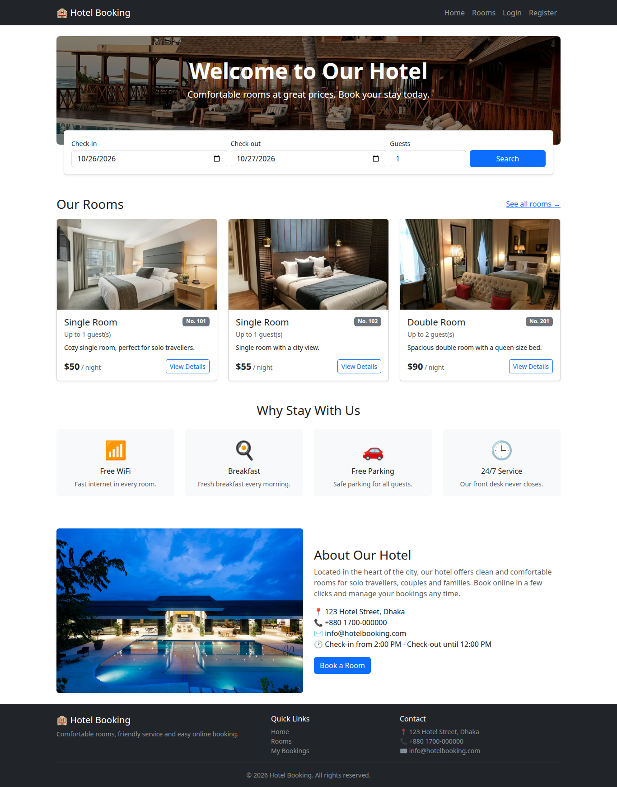
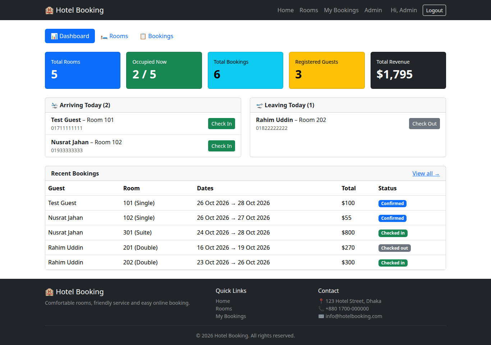
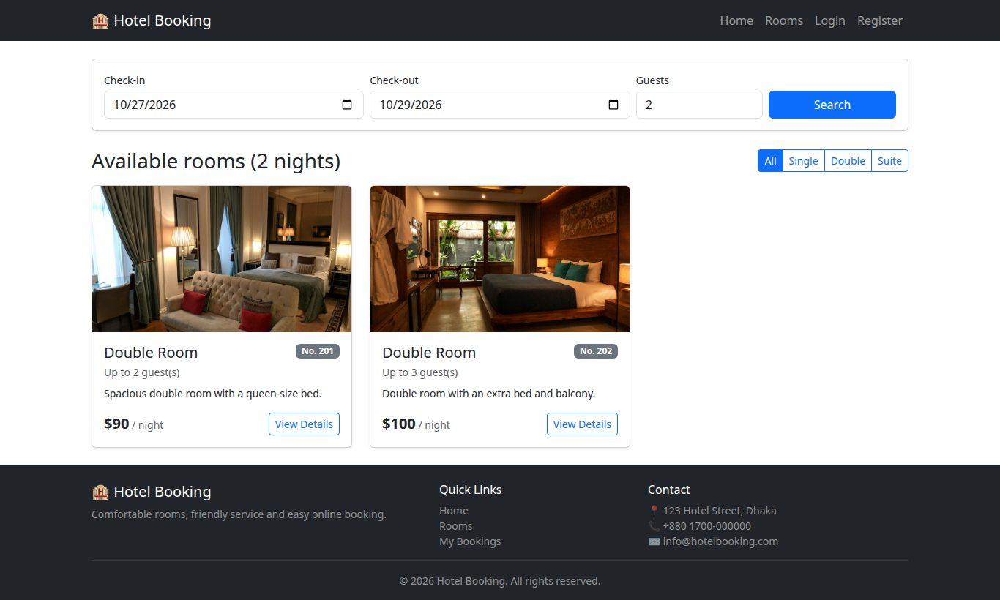
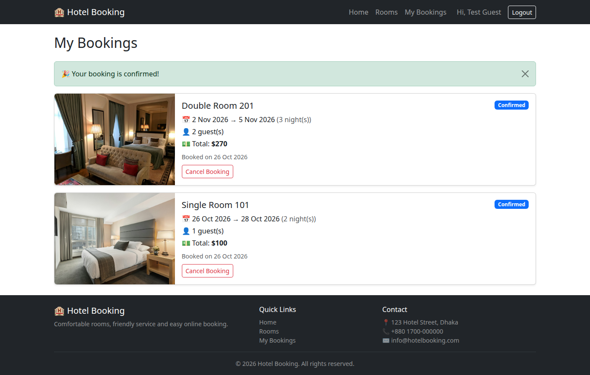
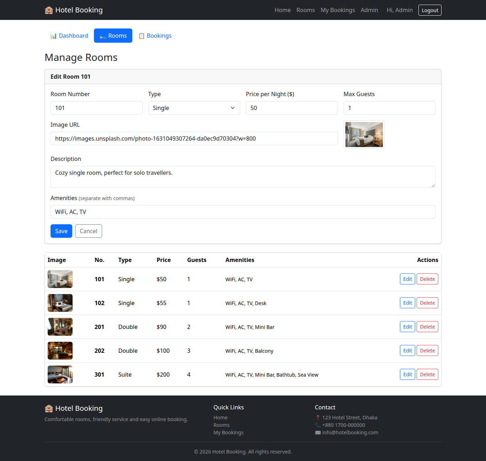

# Hotel Management System

A hotel room booking system built with **Vue 3**, **Node.js/Express** and **MongoDB**.

Guests can search for available rooms, book them and manage their bookings.
Admins can manage rooms and bookings.



## Tech Stack
- **Frontend:** Vue 3, Vite, Vue Router, Pinia, Axios, Bootstrap 5
- **Backend:** Node.js, Express, Mongoose, JWT, bcrypt
- **Database:** MongoDB

## Project Structure
```
backend/    Express REST API
frontend/   Vue 3 app
```

## Getting Started

### 1. Start MongoDB
```bash
docker run -d --name hotel-mongo -p 27017:27017 -v hotel-mongo-data:/data/db mongo:7
```

### 2. Backend
```bash
cd backend
cp .env.example .env      # then change JWT_SECRET
npm install
npm run seed              # adds sample rooms, users and bookings (deletes old data!)
npm run dev               # http://localhost:5000
```

### 3. Frontend
```bash
cd frontend
cp .env.example .env
npm install
npm run dev               # http://localhost:5173
```

## Test Accounts
| Role  | Email           | Password |
|-------|-----------------|----------|
| Admin | admin@hotel.com | 123456   |
| Guest | guest@hotel.com | 123456   |
| Guest | rahim@example.com | 123456 |
| Guest | nusrat@example.com | 123456 |

## Features
- Register / login with JWT authentication
- Search rooms by date, number of guests and room type
- Room details with price calculation
- Book rooms with double-booking prevention
- My Bookings page with cancellation
- Admin dashboard: occupancy, revenue, today's arrivals and departures
- Admin: add / edit / delete rooms
- Admin: all bookings with filters, check-in and check-out

## Screenshots
| Admin Dashboard | Search Results |
|---|---|
|  |  |
| **My Bookings** | **Manage Rooms** |
|  |  |

## Documentation
See [docs/REPORT-GUIDE.md](docs/REPORT-GUIDE.md) for diagrams (ER, use case, architecture, sequence),
API list, test cases and viva notes.
