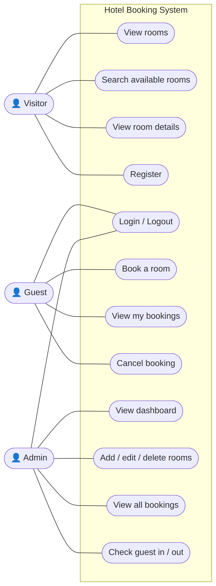
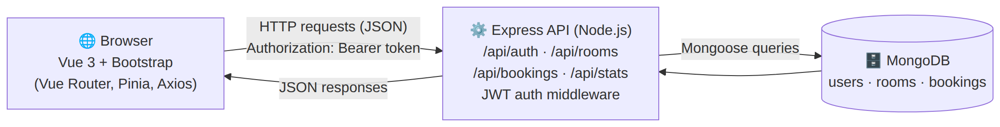
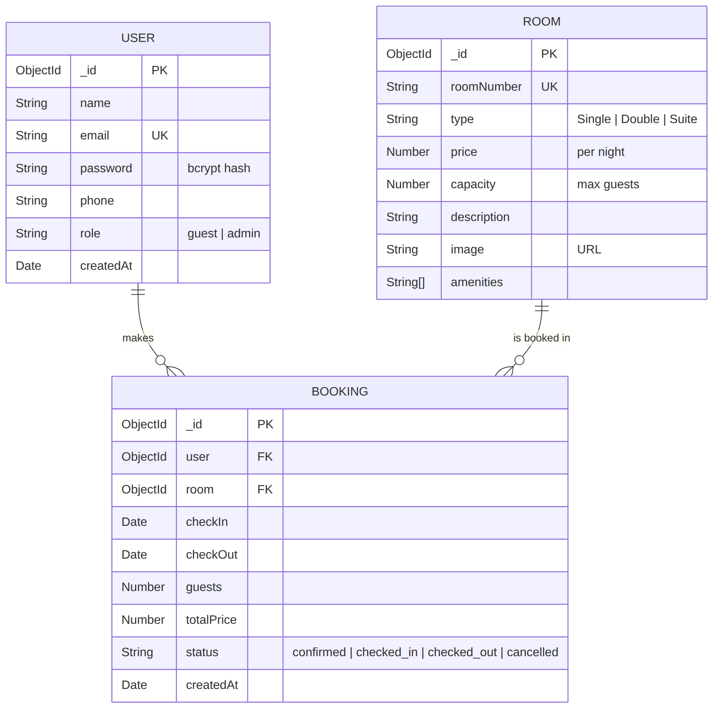
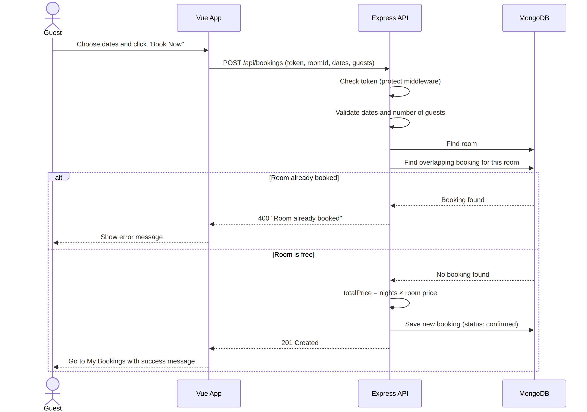
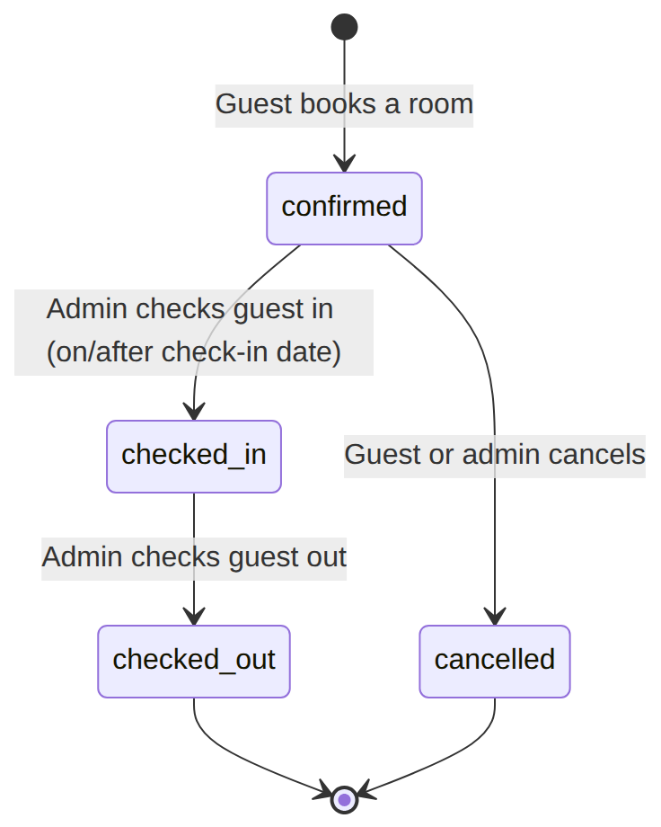

# Project Report Guide

Material for the project report and viva. All diagrams are in [`diagrams/`](diagrams)
(`.png` for Word, `.mmd` source you can edit at https://mermaid.live) and all screenshots are in
[`screenshots/`](screenshots).

---

## Suggested Report Chapters

1. **Introduction** – problem (manual hotel booking is slow and error-prone), objectives, scope
2. **Literature Review / Existing Systems** – e.g. Booking.com, Agoda, hotel PMS software; what they do and how this project is simpler
3. **Requirement Analysis** – functional and non-functional requirements (below), use case diagram
4. **System Design** – architecture diagram, ER diagram, booking sequence diagram, booking status diagram
5. **Implementation** – technologies, folder structure, important code (availability check, JWT auth, status rules)
6. **Testing** – test cases table (below)
7. **Screenshots / User Manual**
8. **Conclusion and Future Work**
9. **References**

---

## 1. Objectives
- Let guests search available rooms by date and number of guests, and book online
- Prevent double booking of the same room
- Let guests view and cancel their bookings
- Give the admin a dashboard to manage rooms, bookings, check-in and check-out

## 2. Functional Requirements
| ID | Requirement | User |
|----|-------------|------|
| FR1 | Register and log in | Guest, Admin |
| FR2 | View all rooms and room details | Everyone |
| FR3 | Search available rooms by check-in, check-out, guests and room type | Everyone |
| FR4 | Book a room for selected dates | Guest |
| FR5 | View own bookings | Guest |
| FR6 | Cancel a confirmed booking before check-in | Guest |
| FR7 | View dashboard (rooms, occupancy, revenue, today's arrivals/departures) | Admin |
| FR8 | Add, edit and delete rooms | Admin |
| FR9 | View and filter all bookings | Admin |
| FR10 | Check guests in and out | Admin |

## 3. Non-Functional Requirements
- **Security:** passwords hashed with bcrypt; JWT tokens; admin routes protected on the server
- **Usability:** simple Bootstrap interface, works on mobile
- **Reliability:** server-side validation; price calculated on the server; double bookings rejected
- **Performance:** dashboard queries run in parallel (`Promise.all`)

## 4. Tools and Technologies
| Part | Technology |
|------|------------|
| Frontend | Vue 3, Vite, Vue Router, Pinia, Axios, Bootstrap 5 |
| Backend | Node.js, Express |
| Database | MongoDB with Mongoose |
| Authentication | JSON Web Token (JWT), bcrypt |
| Tools | VS Code, Git/GitHub, Docker (MongoDB), Postman/curl |

---

## 5. Diagrams

### Use Case Diagram


### System Architecture


### ER Diagram
One user can make many bookings; one room can be in many bookings. `Booking` stores the ids of the user and room (like foreign keys).



### Booking Sequence Diagram


### Booking Status (State) Diagram


---

## 6. API Endpoints
| Method | URL | Access | Description |
|--------|-----|--------|-------------|
| POST | `/api/auth/register` | Public | Create a guest account |
| POST | `/api/auth/login` | Public | Log in, returns a JWT token |
| GET | `/api/auth/me` | Logged in | Current user |
| GET | `/api/rooms` | Public | List rooms (`?checkIn&checkOut&guests&type`) |
| GET | `/api/rooms/:id` | Public | Room details |
| POST | `/api/rooms` | Admin | Add room |
| PUT | `/api/rooms/:id` | Admin | Edit room |
| DELETE | `/api/rooms/:id` | Admin | Delete room (not allowed if it has active bookings) |
| POST | `/api/bookings` | Logged in | Book a room |
| GET | `/api/bookings/my` | Logged in | My bookings |
| PUT | `/api/bookings/:id/cancel` | Owner | Cancel my booking |
| GET | `/api/bookings` | Admin | All bookings (`?status=`) |
| PUT | `/api/bookings/:id/status` | Admin | Check in / check out / cancel |
| GET | `/api/stats` | Admin | Dashboard numbers |

---

## 7. Key Logic (explain these in the viva)

**Availability / double-booking check** – two date ranges overlap when the existing booking starts
before the new one ends **and** ends after the new one starts:
```js
const clash = await Booking.findOne({
  room: roomId,
  status: { $ne: 'cancelled' },
  checkIn: { $lt: newCheckOut },
  checkOut: { $gt: newCheckIn },
});
```
A new guest can check in on the same day the previous guest checks out.

**Authentication** – on login the server creates a JWT containing the user id. The Vue app stores it
and sends it in the `Authorization: Bearer <token>` header. The `protect` middleware verifies it and
`adminOnly` checks the role. Vue route guards only hide pages; the real protection is on the server.

**Price** – calculated on the server (`nights × room price`), so a user cannot send a fake price.

**Booking status rules** – `confirmed → checked_in → checked_out`, or `confirmed → cancelled`.
Any other change is rejected by the server.

---

## 8. Test Cases
| # | Test | Input | Expected Result | Result |
|---|------|-------|-----------------|--------|
| 1 | Register | New name, email, password | Account created, logged in | Pass |
| 2 | Register with used email | Existing email | "Email is already registered" | Pass |
| 3 | Register as admin | `role: "admin"` in request | Account created as **guest** | Pass |
| 4 | Short password | `123` | "Password must be at least 6 characters" | Pass |
| 5 | Login with wrong password | Wrong password | "Invalid email or password" | Pass |
| 6 | Open My Bookings when logged out | `/my-bookings` | Redirect to login | Pass |
| 7 | Guest opens admin page | `/admin` as guest | Redirect to home / 403 from API | Pass |
| 8 | Search available rooms | Dates overlapping a booking | Booked room hidden | Pass |
| 9 | Search on check-out day | Starts on previous guest's check-out day | Room shown | Pass |
| 10 | Check-out before check-in | Wrong dates | "Check-out date must be after check-in date" | Pass |
| 11 | Book in the past | Past date | "Check-in date cannot be in the past" | Pass |
| 12 | Too many guests | 9 guests in a double room | "This room allows 1 to 2 guest(s)" | Pass |
| 13 | Book a room | Valid data | Booking confirmed, total = nights × price | Pass |
| 14 | Double booking | Same room, overlapping dates | "Room is already booked for these dates" | Pass |
| 15 | Cancel another user's booking | Other user's booking id | "You can only cancel your own bookings" | Pass |
| 16 | Cancel own booking | Confirmed future booking | Status = cancelled, dates free again | Pass |
| 17 | Admin adds duplicate room number | Existing number | "Room number already exists" | Pass |
| 18 | Delete room with bookings | Room with active booking | "Cannot be deleted" | Pass |
| 19 | Check in before check-in date | Future booking | "Guest cannot check in before the check-in date" | Pass |
| 20 | Check out without check-in | Confirmed booking | "Cannot change status from confirmed to checked_out" | Pass |
| 21 | Dashboard after check-in | Check in a guest | "Occupied Now" increases by 1 | Pass |
| 22 | Unknown page | `/abc` | 404 page | Pass |

---

## 9. Screenshots
| File | Page |
|------|------|
| `01-home.png` | Home page with search |
| `02-search-results.png` | Available rooms for selected dates |
| `03-room-details.png` | Room details and price calculation |
| `04-login.png`, `05-register.png` | Login and registration |
| `06-my-bookings.png` | Guest's bookings |
| `07-admin-dashboard.png` | Admin dashboard |
| `08-admin-manage-rooms.png` | Add / edit rooms |
| `09-admin-all-bookings.png` | All bookings with check-in / check-out |
| `10-not-found.png` | 404 page |
| `11-mobile-home.png` | Mobile view |

---

## 10. Limitations and Future Work
- Online payment (e.g. SSLCommerz, bKash or Stripe)
- Email confirmation after booking (Nodemailer)
- Upload room photos instead of using image URLs
- Room reviews and ratings
- Printable invoice / PDF receipt
- Use MongoDB transactions so two people booking at the exact same moment cannot both succeed
- Multiple photos per room and more room types

---

## 11. Possible Viva Questions
1. **Why Vue?** Simple to learn, component-based, reactive data, official router and state library.
2. **What is Pinia?** Vue's state store; we keep the logged-in user and token there so every page can use it.
3. **Why JWT instead of sessions?** The server doesn't need to store sessions; the token is sent with each request.
4. **How are passwords stored?** As bcrypt hashes, never plain text.
5. **How do you prevent double booking?** The overlap query above, checked on the server before saving.
6. **Why calculate the price on the server?** The browser can be modified, so the server must not trust prices from it.
7. **Why MongoDB?** Flexible JSON-like documents that match JavaScript objects; easy with Mongoose.
8. **What does `populate()` do?** Replaces a stored id (e.g. `room`) with the full room document.
9. **What is middleware?** A function that runs before the route handler, e.g. `protect` checks the token.
10. **What happens if the token expires?** The API returns 401, the app logs the user out and opens the login page.
